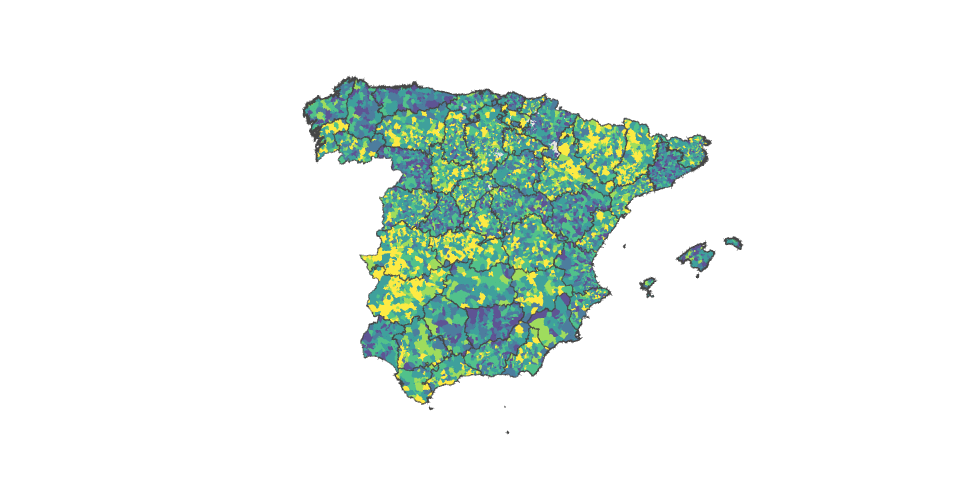

# Where in Spain could you afford to live?

*Could someone earning Spain’s minimum wage afford to rent a room?*

*In which municipalities could they eventually buy an 80 m² home?*

*What would someone need to earn in Barcelona to afford that same home?*

**Spain Housing** is a housing affordability simulator built around questions
like these. Its aim is to make the journey from renting to owning easier to
understand: how rent affects your savings, how income affects your mortgage,
and what both could buy in different parts of Spain.

[Explore the scenarios](#questions-worth-exploring) ·
[Run the map](docs/GEOGRAPHY.md#run-from-this-workspace) ·
[Help with real data](docs/DATA_ACCESS.md)

*Actual application rendering. Real municipal boundaries; explicitly synthetic
prices and rents. The colours illustrate a scenario, not measured affordability.*

> **Current demo:** the map covers 8,132 municipalities using official geography.
> Housing prices and rents are synthetic. Observed market data is still missing,
> so the demo cannot yet answer these questions about real housing conditions.

## From a rented room to a home of your own

A property’s asking price tells only part of the story. Before buying, you need
to build savings while paying rent and everyday expenses. At purchase, you need
enough cash for the deposit and purchase costs, and enough income to support
the mortgage.

Spain Housing brings these pieces together on a map. Change your assumptions
and explore how the picture changes across municipalities:

**Income & living costs → savings over time → purchase budget → affordable space**

The current comparison assumes you **live and buy in the same municipality**.
Saving in one city and buying in another is a future extension.

## Questions worth exploring

These are example scenarios to try, rather than conclusions from the demo.

| Your question | What to explore |
| --- | --- |
| **“I earn minimum wage. Can I rent a room and still save?”** | Enter your take-home income and everyday spending, choose a room-rental stage, and inspect the savings path. |
| **“Could I buy an 80 m² home after seven years?”** | Set a saving horizon and target size, then compare purchase budgets and affordable floor area across municipalities. |
| **“What salary would make an 80 m² home in Barcelona possible?”** | Select Barcelona and adjust net income to explore when the target becomes affordable under your assumptions. An automatic required-income solver is not available yet. |
| **“Would sharing a flat help me buy sooner?”** | Change your share of rent and compare savings. Sharing living costs and taking out a joint mortgage are separate choices. |
| **“What if I kept a larger emergency fund?”** | Increase the savings reserve and see how much remains available for buying. |

Income inputs are **net income**, with annual take-home pay divided by 12.
Future income changes, interest rates and price growth are explicit assumptions.

## Read the map your way

| View | What it helps you understand |
| --- | --- |
| **Target affordability** | How your budget compares with the estimated cost of your chosen home size. |
| **Maximum purchase price** | The purchase budget supported by both your savings and mortgage capacity. |
| **Affordable floor area** | Approximately how many square metres that budget could buy. |

Search for a municipality, adjust your scenario and apply your changes.
You can also download the scenario and results to compare alternatives or
share the assumptions behind a result.

## Real places, illustrative housing costs

The geography is real, including mainland Spain, the islands, Ceuta and Melilla.
The screenshot above shows the mainland and Balearic view. Boundaries come from
official geographic sources; their attribution and reuse terms are documented
in the [geography guide](docs/GEOGRAPHY.md).

The housing inputs are generated demonstration values. They let us exercise the
map and financial model across the country, but they do **not** describe local
markets or establish which towns are genuinely affordable. Access to suitable
observed data, with permission for its intended use, remains the main gap.

Mortgage terms, purchase costs and future growth are adjustable modelling
assumptions. Results describe the scenario you enter, not a mortgage offer.

## Try it locally

Choose your preferred setup:

- **[Conda](docs/GEOGRAPHY.md#option-1-conda)** — create an environment and install the app with pip.
- **[uv](docs/GEOGRAPHY.md#option-2-uv-locked-dependencies)** — use the repository’s locked dependencies.

Follow the guide to launch the map, then open **http://127.0.0.1:8501**.
The national demo also needs the geographic and synthetic-market artifacts:
they are **not included in a Git clone or the Python package**. See the
[data-bundle instructions](docs/GEOGRAPHY.md#portable-data-bundle) for availability
and setup.

## Help turn the demo into a useful public resource

The next step is to connect this working simulator to suitable observed housing
data. Contributions can help with data access and licensing, reviewing financial
assumptions, and making the map easier to understand.

Longer-term goals include comparing a saving location with a different buying
destination and exploring required income more directly.

### Read more

| Guide | What you’ll find |
| --- | --- |
| [Project brief](docs/PROJECT_BRIEF.md) | Purpose, scope and financial assumptions |
| [Geography & running the map](docs/GEOGRAPHY.md) | Setup, data artifacts and geographic attribution |
| [Data access](docs/DATA_ACCESS.md) · [Data options](docs/DATA_OPTIONS_RESEARCH.md) | Observed-data requirements and possible routes forward |
| [Architecture](docs/ARCHITECTURE.md) · [Tests](tests/README.md) | How to work on the code |
| [Current progress](docs/progress/PHASE_7.md) | Executed checks and remaining limitations |
